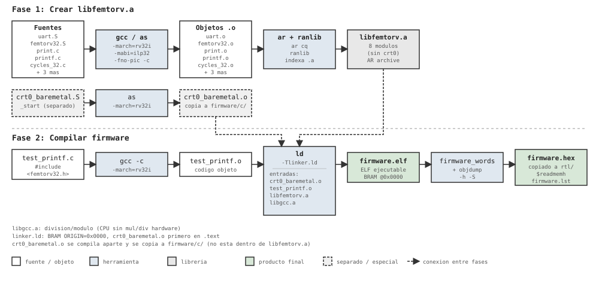

# FemtoRV32 C Firmware

Firmware en C para el procesador femtoRV32 (RISC-V RV32I, sin multiply/divide hardware). Usa una librería estática `libfemtorv.a` con funciones de I/O, timing y sistema.

## Prueba HUB75 en C

`panel_test.c` parte de la prueba de `firmware/asm/panel_test.S`. La variante C actual de Carlos limpia texto y descriptores, escribe **HOLA TU** en las celdas 10…16 y muestra tres sprites. El slot 0 se mueve entre X=0 y X=56 en Y=40; el invasor del slot 1 queda en (28,24), patrón 4 y color 10; el cañón del slot 2 utiliza patrón 1, color 6, Y=56 y X=2*x. Cuando X supera 63 queda fuera de pantalla; no se limita a 56. Se conserva esta elección de prueba, al igual que el retardo de escritura de sprite de 10 iteraciones. No modifica la imagen ni utiliza UART, multiplicador, divisor o conversiones BCD.

El mapa de registros y la explicación de cada campo están en `libfemtorv/include/peripheral_registers.h`, utilizado por `panel_test.c` y `hwmath.c`. El testbench `panel_firmware_TB.v` conserva como referencia la escena anterior **HOLA con cañón fijo**: sus comprobaciones no validan esta variante C modificada. Las pruebas de 115 posiciones documentadas anteriormente corresponden a esa escena anterior. La extracción de macros al header sí se comprobó sobre la variante actual: los objetos compilados de panel y hwmath permanecieron idénticos.

El target **`panel_firmware`** genera `build/panel/panel.elf`, su mapa y desensamblado, y copia `build/panel/firmware.hex` a `rtl/firmware.hex`. Compila RV32I/ILP32 con `-Os` y acceso MMIO `volatile` a la base `0x00470000`. `TEXT_WE` y `SPRITE_WE` se mantienen activos durante una espera de software antes de desactivarse.

Este target tiene un arranque y linker específicos: `panel_start.S` inicializa SP en `0x1000`, GP y BSS; `panel_linker.ld` limita la BRAM a **4 KiB** y reserva al menos 256 bytes para pila. No utiliza el arranque ni el linker genéricos de los otros ejemplos, que conservan configuraciones de memoria distintas. Tampoco requiere enlazar `libfemtorv.a` o `libgcc`.

`PANEL_FRAME_DELAY` vale 100000 para la placa. Para la simulación acelerada puede compilarse con valor 16 y `PANEL_BUILD_DIR=build/panel_sim`, y utilizar el testbench `rtl/cores/Led_panel_AI_12bpp/panel_firmware_TB.v` como top con las fuentes del SoC. El testbench acepta `+UPDATES=1` para comprobar solamente el arranque con retardo normal. Después de simular con retardo reducido, regenerar el firmware con el valor normal antes de construir el bitstream. El retardo C usa un contador `volatile`: conserva la secuencia funcional, pero no pretende tener exactamente la misma duración que el bucle ASM.

El target por defecto sigue siendo el ejemplo `test_printf`; para preparar el panel se debe seleccionar `panel_firmware`. Este paso no graba la placa: requiere reconstruir posteriormente el SoC y su bitstream.

## Estructura del directorio

```
firmware/c/
├── Makefile                  # Build del firmware (compila, linkea, genera .hex)
├── linker.ld                 # Script de linker: BRAM en 0x0000, crt0 primero
├── test_printf.c             # Programa de prueba: printf, getchar, LEDs
├── hello.c                   # Programa mínimo de ejemplo
├── crt0_baremetal.o          # Startup (copiado de libfemtorv/)
├── firmware.elf              # ELF compilado (salida del linker)
├── firmware.hex              # Hex para $readmemh en BRAM (copiado a rtl/)
├── firmware.lst              # Disassembly completo
├── firmware.map              # Mapa de memoria del linker
└── libfemtorv/               # Librería estática
    ├── Makefile              # Build de libfemtorv.a
    ├── femtorv32.inc         # Constantes de IO mapeado en memoria (ASM)
    ├── crt0_baremetal.S      # Startup: gp=IO_BASE, sp=RAM_SIZE, call main
    ├── femtorv32.S           # exit(), abort()
    ├── uart.S                # putchar(), getchar() — I/O UART por polling
    ├── print.c               # print_string, print_dec, print_hex, puts
    ├── printf.c              # printf() minimal (%s, %d, %x, %c)
    ├── cycles_32.c           # cycles() — contador de ciclos (rdcycle)
    ├── wait_cycles.c         # wait_cycles(n) — espera n ciclos
    ├── milliwait.c           # milliwait(ms) — espera en milisegundos
    ├── microwait.c           # microwait(us) — espera en microsegundos
    ├── libfemtorv.a          # Archivo estático (.a) con todos los .o
    ├── crt0_baremetal.o      # Startup compilado (se copia a firmware/c/)
    └── include/
        ├── femtorv32.h           # API pública: IO, printf, getchar, timing
        ├── femtostdlib.h         # Wrappers de stdlib (printf, print_*)
        ├── HardwareConfig_bits.h # Definiciones C de registros IO
        └── HardwareConfig_bits.inc # Definiciones ASM de registros IO
```

## libfemtorv.a

### Qué contiene

`libfemtorv.a` es un archivo estático (AR archive) con 8 módulos objeto:

| Módulo     | Fuente         | Funciones                          |
|------------|---------------|-----------------------------------|
| uart.o     | uart.S        | `putchar`, `getchar`              |
| print.o    | print.c       | `print_string`, `print_dec`, `print_hex`, `print_hex_digits`, `puts` |
| printf.o   | printf.c      | `printf`                          |
| cycles_32.o| cycles_32.c   | `cycles`                          |
| wait_cycles.o | wait_cycles.c | `wait_cycles`                   |
| milliwait.o   | milliwait.c   | `milliwait`                    |
| microwait.o   | microwait.c   | `microwait`                    |
| femtorv32.o   | femtorv32.S   | `exit`, `abort`                |

`crt0_baremetal.o` **no** está dentro de `libfemtorv.a` — se compila por separado y se copia a `firmware/c/` porque el linker lo necesita como primer objeto (definido en `linker.ld`).

### Cómo se crea

```bash
cd libfemtorv
make
```

El Makefile de `libfemtorv/` ejecuta:

1. Compila cada `.c` con `riscv64-unknown-elf-gcc -march=rv32i -mabi=ilp32 -c`
2. Ensambla cada `.S` con `riscv64-unknown-elf-as -march=rv32i -mabi=ilp32 -c`
3. Empaqueta todos los `.o` con `riscv64-unknown-elf-ar cq libfemtorv.a $(OBJECTS)`
4. Indexa con `riscv64-unknown-elf-ranlib libfemtorv.a`
5. Compila `crt0_baremetal.S` → `crt0_baremetal.o` (fuera del .a)

### Cómo ver su contenido

```bash
# Listar módulos dentro del .a
riscv64-unknown-elf-ar t libfemtorv/libfemtorv.a

# Ver símbolos (funciones) de cada módulo
riscv64-unknown-elf-nm libfemtorv/libfemtorv.a

# Disassembly completo de la librería
riscv64-unknown-elf-objdump -d libfemtorv/libfemtorv.a
```

## Compilación del firmware

```bash
make
```

El Makefile de `firmware/c/` ejecuta:

1. **Compilar** `test_printf.c` → `test_printf.o` (gcc -march=rv32i)
2. **Copiar** `crt0_baremetal.o` de `libfemtorv/` a `firmware/c/`
3. **Linkar** `crt0_baremetal.o` + `test_printf.o` + `libfemtorv.a` + `libgcc.a` → `firmware.elf`
   - Script `linker.ld`: todo en BRAM desde 0x0000, crt0 primero
   - `libgcc.a` provee funciones de división/módulo (el CPU no tiene mul/div hardware)
4. **Disassembly** `firmware.elf` → `firmware.lst` (objdump -h -S)
5. **Convertir** `firmware.elf` → `firmware.hex` (herramienta `firmware_words`)
6. **Copiar** `firmware.hex` a `../../rtl/` para simulación

## Memoria mapeada (IO)

| Registro       | Offset  | Lectura                          | Escritura         |
|----------------|---------|----------------------------------|-------------------|
| IO_LEDS        | 0x400004| —                                | LEDs              |
| IO_UART_DAT    | 0x400008| `{24'b0, rx_data[7:0]}`         | tx_data (pulsa TX)|
| IO_UART_CNTL   | 0x400010| `{tx_busy, rx_avail, rx_error}`  | ctrl bits (ver abajo) |
| IO_HW_CONFIG_RAM | 0x402000| Tamaño de BRAM en bytes         | —                 |

Bits de IO_UART_CNTL (escritura):
- bit 0: `tx_wr` — pulso para iniciar transmisión
- bit 1: `rx_ack` — pulso para limpiar `rx_avail`
- bit 2: `ledout` — LED de control

Bits de IO_UART_CNTL (lectura):
- bit 9: `tx_busy`
- bit 8: `rx_avail`
- bit 7: `rx_error`

## Toolchain

```bash
riscv64-unknown-elf-gcc      # compilador C
riscv64-unknown-elf-as       # ensamblador
riscv64-unknown-elf-ld       # linker
riscv64-unknown-elf-ar       # archivero (crea .a)
riscv64-unknown-elf-ranlib   # indexador de .a
riscv64-unknown-elf-objdump  # disassembly
riscv64-unknown-elf-objcopy  # conversión de formatos
```

Flags comunes: `-march=rv32i -mabi=ilp32 -fno-pic --no-relax`

## Diagrama de flujo de compilación



Versión interactiva: abrir `compilation_flow.html` en un navegador.
