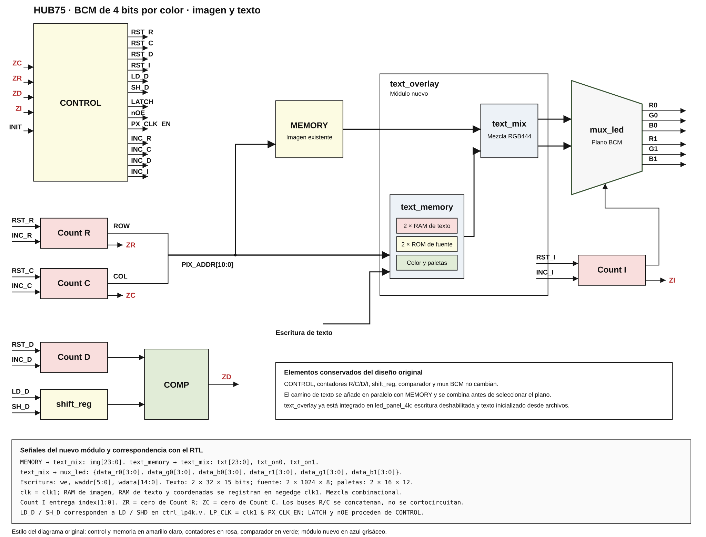
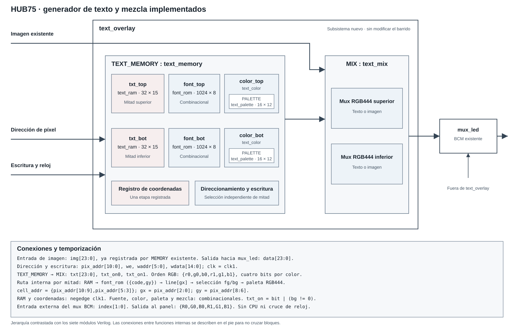
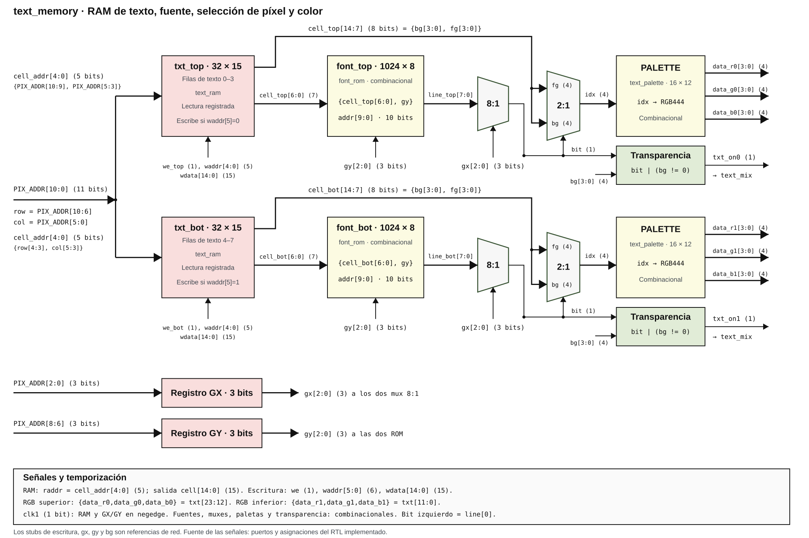

# Generador de texto y mezcla para HUB75 RGB444

## Alcance

Implementación de los bloques de texto propuestos en `hub75_text_memory_diagramas.html`: dos RAM de caracteres, dos ROM de fuente, selección de bit, selección de color, paletas y mezcla independiente para las dos mitades del panel.

**`text_overlay` está integrado en `led_panel_4k.v`, entre la memoria de imagen y `mux_led`.** El Makefile incluye los nuevos módulos. No se modificaron `ctrl_lp4k.v`, los contadores, `memory_V2.v`, `mux_led.v` ni las restricciones de pines. No se implementa una CPU, un periférico MMIO ni un cruce de dominios de reloj.

`text_overlay.v` reúne únicamente el generador y la mezcla. Permite probar o integrar la composición sin alterar el algoritmo BCM.

El motor de sprites y la ampliación de `text_mix` se describen en [Motor de sprites HUB75](sprites.md). `led_panel_4k` incorpora el motor y un cargador de ocho descriptores de demostración. Sus salidas se conectan a `text_overlay`, que mezcla sprites por encima del texto y la imagen. La prueba integrada y su desplazamiento de columna pendiente se detallan en esa página.

## 1. Bloques implementados

### Diagrama general actualizado



[Abrir diagrama general](led_panel_text_blocks.svg). Conserva la distribución y el estilo de la imagen original e incorpora `text_overlay` entre la memoria y el mux BCM. Corrige las etiquetas de retorno: `ZR` corresponde a Count R y `ZC` a Count C. La composición está conectada tanto en el top de hardware como en su simulación.

### Interior del módulo de texto



[Abrir el diagrama SVG](text_overlay_blocks.svg). Muestra los módulos realmente implementados y sus instancias; el mux BCM existente se encuentra fuera de `text_overlay`. Las señales y la temporización se detallan en el pie del diagrama.

### Detalle funcional de text_memory



[Abrir detalle SVG](text_memory_detail.svg). Sigue la distribución del diagrama de referencia: dos caminos horizontales RAM → fuente → mux 8:1 → mux 2:1 → paleta. `cell_addr[4:0]`, `cell_top/bot[6:0]`, `cell_top/bot[14:7]` y `line_top/bot[7:0]` se identifican junto a las conexiones. Los muxes se dibujan como trapecios; el bloque de transparencia representa `bit | (bg != 0)`. Cada mitad tiene su propia RAM, fuente, selección de color y paleta. Los stubs de escritura, `gx`, `gy` y `bg` son referencias de red, no entradas adicionales del módulo.

El detalle incluye los anchos de entrada y salida. GX y GY se muestran como dos registros de 3 bits: reciben únicamente `PIX_ADDR[2:0]` y `PIX_ADDR[8:6]`, respectivamente. La fuente recibe una dirección de 10 bits formada por el código de 7 bits y GY de 3 bits.

```text
PIX_ADDR ──┬── MEMORY existente ── img[23:0] ──────────────────┐
           │                                                  │
           └── text_memory ── txt[23:0], txt_on0, txt_on1 ── text_mix
                                                              │
                                                         data[23:0]
                                                              │
                                                    mux_led existente
                                                              │
                                                   R0 G0 B0 R1 G1 B1
```

| Archivo | Función |
|---|---|
| `text_ram.v` | RAM 32×15, lectura y escritura en flanco descendente |
| `font_rom.v` | ROM combinacional 1024×8 |
| `text_palette.v` | Paleta combinacional 16×12 |
| `text_color.v` | Mux 8:1 de fuente, selección fg/bg, paleta y máscara |
| `text_memory.v` | Dos RAM, dos fuentes, dos bloques de color y registro gx/gy |
| `text_mix.v` | Mezcla RGB444 independiente por mitad: sprite > texto > imagen, sin registros |
| `text_overlay.v` | Composición de `text_memory` y `text_mix` |
| `font8x8.mem` | 128 caracteres × 8 filas, ASCII de 7 bits |
| `pal16.mem` | Paleta RGB444; índice 0 transparente para el fondo, índice 8 negro opaco |

La mezcla y la paleta trabajan con colores completos antes de seleccionar el plano BCM. No reciben `index` ni cambian los tiempos de exposición.

## 2. Direcciones y formato

Para un panel 64×64 con escaneo simultáneo de dos mitades:

```text
pix_addr[10:6] = fila de escaneo, 0..31
pix_addr[5:0]  = columna, 0..63

cell_addr = {pix_addr[10:9], pix_addr[5:3]}
gx        = pix_addr[2:0]
gy        = pix_addr[8:6]
```

Cada carácter ocupa 8×8 píxeles. Hay 8 columnas y 8 filas de caracteres, 64 celdas en total. `txt_top` almacena las filas de texto 0..3 y `txt_bot` las filas 4..7; las dos RAM leen la misma dirección local de 5 bits y producen simultáneamente las dos mitades.

| Campo de celda | Bits | Significado |
|---|---|---|
| `bg` | `[14:11]` | Índice del fondo |
| `fg` | `[10:7]` | Índice del carácter |
| `code` | `[6:0]` | ASCII 0..127 |

El bus de color usa exactamente el orden del controlador existente:

```verilog
{r0[3:0], g0[3:0], b0[3:0], r1[3:0], g1[3:0], b1[3:0]}
```

La fuente está almacenada por carácter y fila: `font_addr = {code, gy}`. **El bit 0 de cada byte representa el píxel izquierdo**, por lo que se utiliza `line[gx]`. No invertir el orden de bits sin convertir también la fuente.

## 3. Interfaz de escritura

`text_memory` y `text_overlay` reciben:

| Puerto | Ancho | Uso |
|---|---:|---|
| `clk` | 1 | Mismo `clk1` que la memoria de imagen |
| `pix_addr` | 11 | Dirección actual del barrido |
| `we` | 1 | Escritura habilitada en el siguiente flanco descendente |
| `waddr` | 6 | `{fila_texto[2:0], columna_texto[2:0]}` |
| `wdata` | 15 | `{bg, fg, code}` |

`waddr[5]` selecciona la mitad: 0 superior, 1 inferior. `waddr[4:0]` selecciona una de sus 32 celdas. Dirección y datos deben estar estables alrededor del flanco descendente de `clk`.

Ejemplos de palabras:

| Palabra | Resultado |
|---|---|
| `15'h0F41` | A amarilla, fg=14, fondo azul bg=1 |
| `15'h07C1` | A blanca, fg=15, fondo transparente bg=0 |
| `15'h0020` | Espacio con fondo transparente: deja ver la imagen |
| `15'h47C1` | A blanca sobre negro opaco, bg=8 |
| `15'h4020` | Espacio con negro opaco: tapa toda la celda |

Para escribir una A blanca en fila de texto 5, columna 2: `waddr=6'd42`, `wdata=15'h07C1`; activar `we` durante un flanco de escritura. `we=0` conserva todas las celdas.

La interfaz es síncrona respecto a `clk1`. Una CPU en otro dominio necesita un adaptador externo: no sincronizar dirección y datos con flip-flops independientes. La escritura simultánea con lectura de la misma celda entrega el contenido anterior en esa lectura y el nuevo en la siguiente.

## 4. Lectura, latencia y transparencia

Las lecturas de ambas RAM y los registros `gx/gy` se actualizan en **`negedge clk1`**, igual que `memory_V2.v`. La fuente, los muxes, la paleta y la mezcla son combinacionales. Tras ese flanco, los colores corresponden a la dirección muestreada; deben estabilizarse antes del siguiente flanco ascendente de `LP_CLK`.

Esto es una etapa registrada, **no** una latencia adicional respecto a la memoria de imagen. Si una dirección cambia después del flanco de lectura, sus datos se obtienen en el siguiente flanco descendente. Un registro extra a la salida de la fuente requeriría realinear también imagen y señales de control; aquí no se añade.

```verilog
glyph_bit = line[gx];
palette_index = glyph_bit ? fg : bg;
txt_on = glyph_bit | (bg != 0);
```

- `bg=0`: fondo transparente. Los píxeles activos de la letra siguen tapando la imagen, incluso si `fg=0` y son negros.
- `bg!=0`: la celda completa es opaca.
- El índice 8 contiene negro para disponer de fondo negro opaco sin perder transparencia.
- `txt_on0` y `txt_on1` se calculan por separado; una mitad puede mostrar texto y la otra conservar su imagen.

Sin archivo de inicialización, cada RAM comienza con 32 espacios transparentes (`15'h0020`). Si se especifica un archivo, se carga exclusivamente mediante `$readmemh`: el archivo debe definir las 32 celdas; no se garantiza un espacio en posiciones omitidas. No hay reset que borre el texto durante el barrido. `TOP_INIT_FILE` y `BOT_INIT_FILE` están vacíos por defecto en el overlay; el top `led_panel_4k` selecciona `text_demo_top.mem` para la mitad superior. `FONT_FILE` y `PALETTE_FILE` seleccionan los archivos de fuente y paleta.

Actualizar una celda durante el refresco puede producir tearing o mezclar contenidos entre planos BCM. No se implementa doble buffer ni actualización atómica de cuadro.

## 5. Punto de integración

La instancia de memoria de imagen existente se conserva. El top conecta su salida `mem_data` al overlay y entrega `mixed_data` al mux BCM:

```verilog
wire [23:0] mixed_data;

text_overlay #(
    .FONT_FILE     (TEXT_FONT_FILE),
    .PALETTE_FILE  (TEXT_PALETTE_FILE),
    .TOP_INIT_FILE (TEXT_TOP_INIT_FILE),
    .BOT_INIT_FILE (TEXT_BOT_INIT_FILE)
) TEXT_OVERLAY (
    .clk      (clk1),
    .pix_addr (PIX_ADDR[10:0]),
    .img      (mem_data),
    .we       (1'b0),
    .waddr    (6'd0),
    .wdata    (15'd0),
    .data     (mixed_data)
);

mux_led mux0 (
    .in0  (mixed_data),
    .out0 ({RGB0, RGB1}),
    .sel  (index)
);
```

Esta conexión ya está aplicada al top. No se añaden puertos físicos: la escritura queda deshabilitada en esta integración y el texto se carga mediante archivos al construir el bitstream.

| Parámetro del top | Valor predeterminado | Función |
|---|---|---|
| `TEXT_FONT_FILE` | `font8x8.mem` | Fuente ASCII |
| `TEXT_PALETTE_FILE` | `pal16.mem` | Paleta RGB444 |
| `TEXT_TOP_INIT_FILE` | `text_demo_top.mem` | HOLA/MUNDO multicolor en la mitad superior |
| `TEXT_BOT_INIT_FILE` | cadena vacía | Mitad inferior transparente: conserva la imagen |

Las imágenes se cargan como antes desde `image0.hex` e `image1.hex`. Para mostrar solo imagen, usar cadenas vacías en los dos parámetros de texto. Para superponer letras sobre la imagen, usar `bg=0` en las celdas deseadas; para fondo opaco, usar un índice distinto de cero. Para texto en toda la pantalla, cargar también un archivo de 32 celdas en `TEXT_BOT_INIT_FILE`.

Modificar el mensaje, sus colores, la fuente o la imagen requiere regenerar el bitstream. La escritura dinámica de CPU sigue disponible en la interfaz de `text_overlay`, pero no está expuesta por este top: añadirla será otra integración.

Se usan los 11 bits de dirección de píxel necesarios para 64×32 pares. El ancho del contador de filas y su relación con la salida física `ROW` permanecen tal como estaban; no se corrigen como parte de esta entrega.

## 6. Pruebas y síntesis

### SVG automáticos desde el Makefile general

| Comando | Resultado |
|---|---|
| `make svg` | Genera los diagramas del TOP general y del TOP de texto |
| `make svg_top` | `build/svg/led_panel_4k.svg` |
| `make svg_text` | `build/svg/text_overlay.svg` |
| `make svg-flat` | `build/svg/led_panel_4k_flat.svg`, diagrama general aplanado |

Los targets jerárquicos usan Yosys y `netlist2svg`; `svg-flat` conserva el renderer `netlistsvg` porque el instalado `netlist2svg` falla con el trazado aplanado de este diseño. No abren ventanas ni programan hardware. Los JSON intermedios y logs quedan en `build/svg`, sin sobrescribir las netlists de síntesis. `TOP`, `TEXT_TOP`, `SVG_DIR`, `SVG_RENDERER` y `SVG_FLAT_RENDERER` pueden sobrescribirse al invocar Make. Los diagramas manuales de `Docs` mantienen su estilo y no se reemplazan.

Desde este directorio, los targets adicionales están en **`Makefile.text`**, separados del flujo existente:

```bash
make -f Makefile.text test_text
make -f Makefile.text synth_text
```

El primero ejecuta un testbench autochecking con la memoria de imagen y el mux BCM originales. Produce `build/text/text_overlay_TB.vcd`, sin abrir ventanas ni programar hardware. El segundo sintetiza únicamente el overlay para iCE40 y ejecuta `check -assert`.

Verificado el 2026-10-22:

- Texto inicial vacío: conserva todos los píxeles de imagen.
- Las 64 celdas y las dos mitades se direccionan de forma independiente.
- 128 caracteres, cada uno con sus 64 píxeles.
- Selección de fg/bg, fondo transparente y negro opaco.
- Lectura alineada con la memoria existente y salida estable antes del flanco de lectura.
- Escritura sobre la celda leída: contenido anterior en esa lectura.
- **49 172 comparaciones** de las seis salidas RGB, incluyendo los cuatro planos BCM.
- Síntesis del overlay: **1193 LUT4, 45 DFF y 2 bloques RAM de 4 Kibit**; `check -assert` sin problemas. Son recursos solo del overlay, no del sistema completo.

Las RAM pequeñas de texto se infirieron como BRAM y las fuentes combinacionales como lógica en la prueba aislada. El uso final cambia al integrar texto inicializado constante. La inicialización por archivo superior está cubierta por el demo integrado; el archivo inferior opcional no tiene una prueba específica. La visibilidad física del mensaje fue confirmada por Carlos el 2026-10-27; véase la corrección de inicialización siguiente.

### Corrección de inicialización para síntesis — 2026-10-27

**Síntoma:** el panel mostraba únicamente la imagen, aunque la simulación RTL cargaba el mensaje. En la netlist sintetizada, `TEXT_OVERLAY.TEXT_MEMORY.cell_top` quedó como espacio transparente (`15'h0020`) y `txt_on0` como cero; el mezclador seleccionaba la imagen.

**Causa comprobada:** `text_ram.v` inicializaba primero todas las celdas con un `for` y después ejecutaba `$readmemh`. En el Yosys instalado, la síntesis de ese bloque conservaba los espacios en lugar del contenido del archivo. La síntesis aislada de `text_ram`, con `INIT_FILE="text_demo_top.mem"`, reprodujo el resultado: las primeras celdas eran `0020` en vez de `4648`, `454F`, `44CC`, `4741`.

**Cambio aplicado:** hacer excluyentes la carga del archivo y el llenado con espacios:

```verilog
initial begin
    if (INIT_FILE != "")
        $readmemh(INIT_FILE, MEM);
    else
        for (i = 0; i < 32; i = i + 1)
            MEM[i] = 15'h0020;
end
```

No se cambiaron el formato de celda, la fuente, la paleta, el mezclador ni el barrido.

**Validación:**

- Síntesis aislada: las 32 palabras de inicialización coinciden exactamente con `text_demo_top.mem`.
- Regresión `text_overlay_TB`: pasan las 49 172 comparaciones BCM.
- Panel físico: Carlos confirmó el 2026-10-27 que se ve «HOLA MUNDO» en diferentes colores. Esta confirmación acredita la visibilidad del texto, no la correspondencia exacta de cada píxel ni la corrección del desplazamiento descrito en la sección 8.

### Validación del top integrado — 2026-10-23

- Las 49 172 comparaciones aisladas siguen aprobadas.
- El testbench toma las salidas RGB del top real, sin un overlay ni mux externos.
- Comparación VCD antes/después de integrar: idénticos datos RGB, flancos de carga y tiempos de exposición.
- Síntesis completa: `check -assert` sin problemas. Para el demo de texto constante, place-and-route usa **154/5280 celdas LC y 14/30 bloques RAM**.
- Bitstream iCEBreaker generado en `build/text/led_panel_text.bin`, sin programar la placa. Se comprobó timing a 12 MHz; el análisis de `clk1` también se hizo conservadoramente a 12 MHz, aunque el divisor existente lo reduce a 2 MHz en esa placa.
- Se conserva la política del PCF original de permitir `init` sin restricción. Ese puerto está sin uso en el RTL y nextpnr le asigna un pin automáticamente. También hay restricciones antiguas RXD/TXD/LEDS que no corresponden a este top. No se cambiaron esos pines ni se eliminó el puerto.
- Se conserva el desplazamiento de una columna y la temporización BCM descritos en la sección 8; integrar el texto no corrige esos problemas.

Targets adicionales, sin acceso a hardware:

```bash
make -f Makefile.text synth_text_display
make -f Makefile.text build_text_display_icebreaker
```

El Makefile original también incluye ya los siete módulos de texto en `COMM_OBJS`; sus targets de construcción usan el top integrado. Sus flujos propietarios Gowin heredados no se han convertido ni se han usado en esta validación.

### Síntesis y configuración de la FPGA iCEBreaker

Este procedimiento corresponde a **iCE40UP5K, encapsulado SG48, reloj de 12 MHz**, con el pinout de `led_panel_icebreaker.pcf`. No utilizar este bitstream para una FPGA Gowin u otra placa.

Herramientas requeridas en el PATH: `yosys`, `nextpnr-ice40`, `icepack` e `iceprog`. Ejecutar desde `basic_circuits/test_peripherals/rtl/cores/Led_panel_AI_12bpp`.

#### 1. Preparar imagen y texto

- `image0.hex`: imagen superior, 2048 palabras RGB444 de 12 bits.
- `image1.hex`: imagen inferior, 2048 palabras RGB444 de 12 bits.
- `text_demo_top.mem`: 32 celdas de la mitad superior, cada una `{bg[3:0],fg[3:0],code[6:0]}`.
- `font8x8.mem` y `pal16.mem`: fuente y paleta.

Con los parámetros predeterminados se presenta HOLA/MUNDO multicolor sobre negro en la mitad superior y la imagen original en la inferior. Cualquier cambio de estos archivos requiere volver a construir y cargar el bitstream.

#### 2. Sintetizar y construir el bitstream

```bash
make -f Makefile.text build_text_display_icebreaker
```

Ejecuta síntesis del **top completo `led_panel_4k`**, place-and-route y empaquetado. No accede al programador y no modifica la FPGA. El target no permite ignorar fallos de timing.

| Archivo de salida | Contenido |
|---|---|
| `build/text/led_panel_text_synth.log` | Log de síntesis y comprobación del diseño |
| `build/text/led_panel_text.json` | Netlist sintetizada |
| `build/text/led_panel_text.asc` | Configuración colocada y ruteada |
| `build/text/led_panel_text.bin` | Bitstream que se debe cargar |

Antes de cargar, comprobar que la construcción terminó con éxito y que los relojes pasan la restricción de 12 MHz. Las advertencias heredadas del PCF sobre `init` y puertos RXD/TXD/LEDS se describen arriba; no son puertos nuevos del módulo de texto.

#### 3. Configurar la placa

Con el panel correctamente alimentado y las señales HUB75 conectadas según el PCF, cargar el archivo recién construido:

```bash
iceprog -d i:0x0403:0x6010 build/text/led_panel_text.bin
```

**Este comando escribe y verifica la Flash SPI de la placa**; la configuración es persistente. No es una carga temporal en SRAM. No ejecutarlo si hay varios programadores FTDI coincidentes sin identificar previamente el dispositivo correcto.

Después de programar, activar y liberar `rst` del controlador para comenzar desde un estado conocido. Para pruebas sucesivas, volver a aplicar ese reset después de cada carga.

La visibilidad del texto en la placa fue confirmada por Carlos el 2026-10-27 tras la corrección de inicialización de `text_ram.v`. El desplazamiento de una columna documentado en la sección 8 no se considera corregido por esta validación visual.

## 7. Fuente y paleta

### Captura de señales hacia el display

El target `make -f Makefile.text sim_text_display` genera `build/text/text_display_TB.vcd`.
El testbench `text_display_TB.v` instancia el top integrado `led_panel_4k` y conecta directamente sus salidas RGB al display simulado. No contiene un overlay ni un mux externos. Las señales `img`, `mixed`, `pix_addr` e `index` en la raíz son alias de observación del top.

La memoria superior se inicializa mediante `text_demo_top.mem`: **HOLA** en la fila de texto 0 y **MUNDO** en la fila 1. Solo las celdas ocupadas por esas letras conservan fondo negro opaco (`bg=8`), y cada letra tiene un color diferente. Desde el 2026-10-27, todas las celdas no utilizadas contienen espacios transparentes (`0020`, `bg=0`): las cuatro restantes de la fila 0, las tres restantes de la fila 1 y todas las de las filas 2 y 3 dejan ver la imagen. La mitad inferior conserva la imagen original. Este cambio del archivo requiere reconstruir y cargar el bitstream; su resultado físico está pendiente de confirmación. Las capturas y mediciones de la sección 8 corresponden al demo anterior, con toda la mitad superior opaca.

| Letra | Índice fg | RGB444 | Color |
|---|---:|---|---|
| H | 12 | `F00` | Rojo |
| O de HOLA | 10 | `0F0` | Verde |
| L | 9 | `00F` | Azul |
| A | 14 | `FF0` | Amarillo |
| M | 11 | `0FF` | Cian |
| U | 13 | `F0F` | Magenta |
| N | 15 | `FFF` | Blanco |
| D | 6 | `A50` | Marrón anaranjado |
| O de MUNDO | 7 | `AAA` | Gris claro |

En la raíz `text_display_TB` del VCD están `LP_CLK`, `LATCH`, `NOE`, `ROW`, `RGB0`, `RGB1`, `pix_addr` e `index`. Las 64 palabras de RAM se incluyen explícitamente bajo `SCANNER.TEXT_OVERLAY.TEXT_MEMORY.txt_top.MEM[0..31]` y `txt_bot.MEM[0..31]`. `text_display_sim.gtkw` está actualizado para esta jerarquía.

La captura termina al comenzar la siguiente vuelta física de 32 filas después de los cuatro planos. Se verificó una duración de 2,20069 ms con reloj de FPGA simulado a 50 MHz. Esta prueba es de observación del barrido existente: no sustituye las comparaciones autochecking de `test_text` ni corrige particularidades de su temporización. Icarus emite avisos de nombres escapados al volcar las palabras de RAM; se comprobó que las 64 están presentes en el VCD.

`font8x8.mem` deriva de [`font8x8_basic.h`](https://github.com/dhepper/font8x8/blob/8e279d2d864e79128e96188a6b9526cfa3fbfef9/font8x8_basic.h), revisión `8e279d2d864e79128e96188a6b9526cfa3fbfef9`.

Autor: Daniel Hepper; fuente declarada de **dominio público**, basada en el trabajo de Marcel Sondaar y las fuentes VGA de IBM. Conserva el orden original de bits, con el bit menos significativo a la izquierda. Solo incluye ASCII de 7 bits: no interpreta UTF-8 ni caracteres acentuados.

Para regenerarla a partir de una copia de ese archivo:

```bash
python3 gen_font_mem.py ruta/al/font8x8_basic.h
```

`gen_font_mem.py` valida 128 caracteres de ocho filas y el patrón de referencia de A antes de generar el archivo. El archivo `.mem` ya está incluido; descargar el repositorio de la fuente no es necesario para simular o sintetizar.

`pal16.mem` contiene 16 palabras de 12 bits en orden RGB444. Su índice 14 es amarillo `FF0`, el 15 blanco `FFF`, y los índices 0 y 8 son negros `000`. La paleta es fija durante la ejecución; modificar el archivo requiere reconstruir el diseño.

## 8. Reconstrucción de las salidas reales del display

**Resultado de la comprobación integrada: FALLA la correspondencia exacta de columnas.** El mensaje se reconoce, pero está desplazado un píxel a la derecha. La misma desviación existe en la imagen inferior. No se modificó el RTL para corregirla.

| Salida reconstruida del VCD | Referencia esperada |
|---|---|
|  |  |

Las imágenes son ampliaciones de un cuadro de 64×64 píxeles, sin interpolación. Se usa el orden de columnas del diseño: el primer dato retenido representa x=0. Una orientación física invertida del panel puede requerir otra presentación, pero no cambia la comparación de la secuencia transmitida.

### Método

`reconstruct_text_display.py` lee el VCD generado por `sim_text_display` y reconstruye la trama usando solamente los puertos externos `RGB0`, `RGB1`, `LP_CLK`, `LATCH`, `ROW` y `NOE`:

1. Captura `{RGB0,RGB1}` justo antes de cada flanco ascendente de `LP_CLK`. No usa `mixed`, `txt`, `pix_addr` ni el `index` interno para reconstruir los datos.
2. Conserva los últimos 64 datos del registro de desplazamiento y toma su contenido cuando sube `LATCH`.
3. Comprueba la secuencia de 32 direcciones `ROW`, con cuatro cargas consecutivas por fila. Reconstruye los nibbles RGB444 asignando esas cuatro cargas a los planos 0, 1, 2 y 3.
4. Construye independientemente la referencia a partir de las celdas de `text_demo_top.mem`, la fuente, la paleta y la imagen inferior. Compara los 4096 píxeles completos, sin compensar desplazamientos.

La imagen reconstruida representa los códigos RGB444 nominales, no una integración fotométrica de los tiempos de exposición. `NOE` se analiza por separado para medir la duración de cada plano.

### Resultados medidos

| Comprobación | Resultado |
|---|---|
| Pulsos LATCH disponibles | 129; se usan los primeros 128 para un cuadro |
| Pulsos LP_CLK por carga en el VCD estabilizado | 64 en las primeras 128 cargas |
| Muestras de seis bits en el cuadro | 8192 |
| Píxeles RGB444 reconstruidos | 4096 |
| Diferencias respecto a la referencia | **981 píxeles** |
| Diferencias en la mitad superior | **204** |
| Diferencias en la mitad inferior | **777** |
| Cambios de RGB en el mismo instante VCD que su muestreo | 0 |
| Diferencias respecto al modelo de desplazamiento descrito abajo | **0** |

En ambas mitades, para todas las filas y colores:

```text
salida[y][0] = referencia[y][0]
salida[y][x] = referencia[y][x-1], para x=1..63
```

Por tanto, se repite la columna 0 y se omite la columna 63. Esta conclusión procede de la salida capturada, no únicamente de inspeccionar la RAM. No se ha aplicado una corrección al barrido ni se ha atribuido el defecto a la fuente: también afecta al camino de imagen.

El testbench integrado contaba previamente 8386 eventos de desplazamiento mediante `always @(posedge LP_CLK)`, mientras que el VCD estabilizado contiene 8256 flancos ascendentes en toda la captura, incluidos los 64 de la carga 129. La diferencia indica transiciones delta no conservadas como niveles duraderos en el VCD; no se confunde ese contador de eventos con los 8192 datos del primer cuadro reconstruido. La captura VCD no permite determinar el efecto eléctrico de pulsos breves en el FPGA físico.

### Tiempos de exposición

El intervalo con `NOE=0` después de cada LATCH fue idéntico en las 32 filas:

| Plano | Tiempo medido | Ciclos de clk1, período 120 ns |
|---|---:|---:|
| 0 | 2760 ns | 23 |
| 1 | 5040 ns | 42 |
| 2 | 9840 ns | 82 |
| 3 | 19440 ns | 162 |

Los tiempos efectivos son **23:42:82:162**, no exactamente 1:2:4:8. Incluyen la sobrecarga del control existente. Esta desviación temporal es independiente del desplazamiento de columnas; tampoco fue corregida en esta tarea.

### Repetir la verificación

Desde este directorio:

```bash
make -f Makefile.text sim_text_display
python3 reconstruct_text_display.py
```

El script actualiza las dos imágenes de esta sección y **devuelve código de salida 1 si los píxeles no coinciden**. No declara aprobada una imagen por el solo hecho de que el texto sea legible. La salida `PASS` del testbench de captura anterior solo indica que terminó su recorrido; no es una validación de sus píxeles.

Esta prueba complementa `test_text`: las 49 172 comparaciones del generador y la mezcla aislados siguen siendo válidas, pero no garantizan la alineación con el barrido real. Carlos confirmó la visibilidad física de «HOLA MUNDO» en diferentes colores el 2026-10-27; la alineación exacta de píxeles en hardware sigue sin verificarse.
